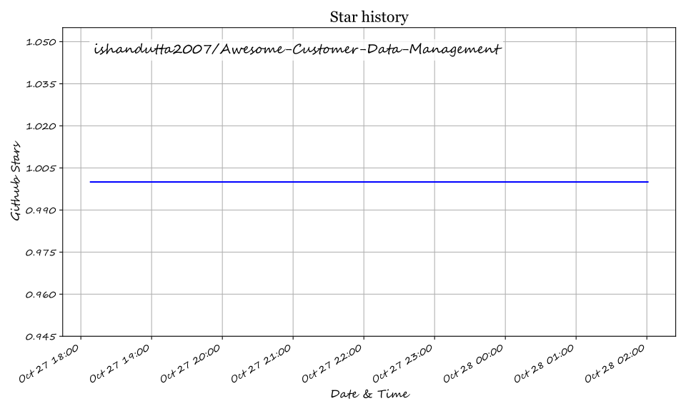

  

# 🚀 Awesome Customer Data Management

  
  
  
  
  
  
  

---

> 🌟 **A curated directory of leading SaaS Customer Data Platforms (CDP) and top Open-Source Customer Data Management tools.**  
> *Covering unified customer profiles, real-time identity resolution, audience segmentation, Reverse ETL, clickstream tracking, and warehouse-native data activation.*

---

## 📑 Table of Contents

- [📊 Sector Overview & Market Dynamics](#-sector-overview--market-dynamics)
- [🏢 SaaS & Hosted Customer Data Platforms](#-saas--hosted-customer-data-platforms)
- [💻 Open-Source GitHub Projects](#-open-source-github-projects)
- [🤝 How to Contribute](#-how-to-contribute)
- [💖 Support](#-support)
- [📈 Star History](#-star-history)
- [⚖️ Disclaimer](#️-disclaimer)

---

## 📊 Sector Overview & Market Dynamics

The global **Customer Data Platform (CDP)** market is estimated between **$7.5B and $9.5B** in 2024–2025 and is projected to cross **$10.4B–$12.8B by 2026**, advancing at a compound annual growth rate (**CAGR**) of ~23%–28%. 

Rather than coalescing into a single "winner-take-all" monopoly, the sector remains **highly fragmented**. Market dynamics are split across three major archetypes:
1. **Enterprise Suite / Packaged CDPs** (Salesforce Data Cloud, Twilio Segment, Tealium, Bloomreach) offering end-to-end identity resolution, UI-driven marketer journeys, and turnkey integrations.
2. **Composable & Warehouse-Native CDPs** (RudderStack, Multiwoven, drt) building pipelines directly on top of cloud data warehouses like Snowflake, BigQuery, and Databricks.
3. **Open-Source & Privacy-First Foundations** (PostHog, Apache Unomi, Snowplow, Jitsu, Pimcore) enabling complete data sovereignty, zero egress vendor lock-in, and full GDPR/CCPA governance compliance.

---

## 🏢 SaaS & Hosted Customer Data Platforms

*Enterprise SaaS platforms ranked by company valuation / market capitalization (descending).*

| Platform | Company Size (Valuation / Market Cap) | Starting Price | Free Tier / Trial Limits | Description & Best For |
| :--- | :--- | :--- | :--- | :--- |
| **[Salesforce Data Cloud](https://www.salesforce.com/data/)** | ~$200B+ Market Cap ($34.9B+ FY24 Rev) | $500/mo (via 100k Flex Credits min) / $60,000/yr (Data 360 Starter) | 30-day trial with standard sandbox limits (or $0 Provisioning SKU for existing CRM customers) | Enterprise customer data platform integrated with Salesforce ecosystem. Best for Salesforce customers wanting unified customer profiles across Sales, Service, and Marketing clouds. |
| **[Workday Customer Data Management](https://www.workday.com/)** | ~$50B–$55B Market Cap ($7.3B+ FY24 Rev) | ~$35 to $100 per employee/mo (billed annually, custom enterprise contract) | 30-day proof-of-concept / evaluation period via sales (no self-serve free tier) | Customer data management within Workday Financials and HCM suite. Best for enterprises wanting customer master records integrated directly into financial planning and ERP operations. |
| **[Segment](https://segment.com/)** (Twilio) | ~$40B–$47B Market Cap (Parent Twilio) | $120/mo (Team plan with 10,000 MTUs included) | Free forever: 1,000 MTUs/mo, 2 sources, 300+ integrations; 14-day free trial on Team tier | Customer data platform for collecting, cleaning, and routing data. Best for product and growth teams wanting a developer-friendly event pipeline. |
| **[Bloomreach](https://www.bloomreach.com/)** | ~$2.2B Valuation | $5,000/mo ($60,000/yr starting tier) | 14-day guided proof-of-concept sandbox via sales (no self-serve free tier) | Commerce experience platform with integrated CDP for personalization. Best for e-commerce brands wanting customer data unified with search, merchandising, and marketing. |
| **[Tealium](https://tealium.com/)** | ~$1.2B Valuation | $1,000/mo ($12,000/yr billed annually for Data Cloud Activation) | 30-day guided proof-of-concept for qualified prospects (no self-serve free tier) | Enterprise CDP and tag management platform with real-time data activation. Best for large enterprises needing governance-first data collection across web, mobile, and offline channels. |
| **[Amperity](https://amperity.com/)** | ~$1.0B Valuation | ~$16,666/mo ($200,000/yr starting tier, based on Amps compute units) | 30-day enterprise sandbox / POC on sales engagement (no self-serve free tier) | Enterprise CDP specializing in AI identity resolution and customer 360. Best for retail and consumer brands with complex, fragmented offline and online customer records. |
| **[Treasure Data](https://www.treasuredata.com/)** | ~$600M+ Valuation (Arm acquisition $600M, $234M SoftBank round) | ~$5,000/mo ($60,000/yr enterprise base contract based on profile tiers) | 30-day complimentary proof-of-concept (POC) using customer data (no self-serve free tier) | Enterprise CDP and AI data platform. Best for data-heavy enterprises needing tight alignment between customer records and machine learning/analytics workflows. |
| **[ActionIQ](https://www.actioniq.com/)** | ~$511M Valuation (Acquired by Uniphore) | ~$8,333/mo ($100,000/yr starting tier) | 30-day guided POC / staging deployment (no self-serve free tier) | Enterprise CDP focused on marketing activation and hybrid/composable architecture. Best for large enterprises wanting composable data activation on top of existing cloud warehouses. |
| **[mParticle](https://www.mparticle.com/)** | $300M (Acquired by Rokt) | ~$3,000/mo (estimated entry contract based on mParticle Credits) | 14-day sales-assisted developer sandbox POC (no self-serve free tier) | Customer data platform tailored for mobile-first and omnichannel identity resolution. Best for mobile-first apps needing real-time audience segmentation and SDK pipelines. |
| **[RudderStack](https://www.rudderstack.com/)** | ~$300M Valuation ($82M Raised) | $265/mo (Growth tier) | Free forever: 250,000 events/mo (plus 14-day free trial of Growth tier; open-source core is 100% free) | Warehouse-first customer data pipeline. Best for engineering and data teams building a Segment alternative directly in Snowflake, BigQuery, or Databricks. |

---

## 💻 Open-Source GitHub Projects

*Self-hosted open-source Customer Data Platforms, event tracking engines, Reverse ETL, and customer identity frameworks. Ranked by GitHub_Stars (descending).*

### 1. [PostHog](https://github.com/posthog/posthog) 
- **Description**: The all-in-one open-source customer data and product intelligence platform. Combines event tracking, customer personas, session replays, feature flags, A/B testing, and warehouse data pipelines.
- **License**: MIT / PostHog Open-source
- **Tech Stack**: Python (Django), ClickHouse, TypeScript, React
- **Best For**: Engineering and product teams wanting a full-featured customer data and analytics platform self-hosted or managed.

### 2. [Snowplow](https://github.com/snowplow/snowplow) 
- **Description**: Enterprise-grade Behavioral Data Platform (BDP) generating rich, high-fidelity first-party customer behavioral event streams directly into your cloud warehouse or real-time stream.
- **License**: Snowplow Limited Use License / Apache 2.0 components
- **Tech Stack**: Scala, Apache Kafka, Spark, Cloud Kinesis/PubSub
- **Best For**: Data-mature organizations requiring high-integrity, schema-enforced behavioral customer event collection.

### 3. [Jitsu](https://github.com/jitsucom/jitsu) 
- **Description**: High-performance, open-source Segment alternative and event collection pipeline. Fully scriptable customer event ingestion engine with real-time routing to databases, data warehouses, and marketing APIs.
- **License**: MIT
- **Tech Stack**: TypeScript, Go, ClickHouse, Kafka
- **Best For**: Modern developers needing a fast, lightweight, scriptable clickstream ingestion engine without vendor lock-in.

### 4. [RudderStack Server](https://github.com/rudderlabs/rudder-server) 
- **Description**: Warehouse-first Customer Data Pipeline and Segment alternative. Collects, enriches, and routes first-party customer event data to cloud warehouses (Snowflake, BigQuery, Redshift, ClickHouse) and dozens of business destinations with deep SDK coverage.
- **License**: AGPL-3.0
- **Tech Stack**: Go, TypeScript, React
- **Best For**: Data teams aiming to own their event data pipeline and build customer data infrastructure directly inside their warehouse.

### 5. [Pimcore Customer Management Framework](https://github.com/pimcore/pimcore) 
- **Description**: Open-source platform offering Customer Data Platform (CDP), Master Data Management (MDM), and Product Information Management (PIM) capabilities. Unifies customer master records, GDPR consent logs, and omnichannel interactions.
- **License**: GPL-3.0
- **Tech Stack**: PHP (Symfony), MySQL, Elasticsearch
- **Best For**: Organizations managing master records, catalog data, and customer identities in a unified data governance suite.

### 6. [Multiwoven](https://github.com/Multiwoven/multiwoven) 
- **Description**: Open-source Reverse ETL and customer data activation platform. Syncs customer profiles, segments, and behavioral traits from your cloud data warehouse (Snowflake, Databricks, BigQuery, PostgreSQL) into CRMs, marketing tools, and advertising channels.
- **License**: AGPL-3.0
- **Tech Stack**: Ruby on Rails, React, Python
- **Best For**: Data engineers and marketing operations teams looking to activate customer warehouse tables without per-row SaaS charges.

### 7. [Grouparoo](https://github.com/grouparoo/grouparoo) 
- **Description**: Open-source Reverse ETL framework built by the community (now maintained open-source) to define customer records, build cohorts, and sync them back to marketing and sales tools.
- **License**: MPL-2.0
- **Tech Stack**: Node.js, TypeScript, React
- **Best For**: Developers looking for an open-source, code-first customer data synchronization tool.

### 8. [Tracardi](https://github.com/Tracardi/tracardi) 
- **Description**: Composable, API-first Customer Data Platform and workflow orchestration engine. Enforces customer data unification, real-time segmentation, automated user journeys, and micro-moment personalization via an intuitive visual graph interface.
- **License**: MIT
- **Tech Stack**: Python, Elasticsearch, React
- **Best For**: Developers and marketers seeking an agile Python-based CDP with visual workflow automation and RESTful endpoint management.

### 9. [Apache Unomi](https://github.com/apache/unomi) 
- **Description**: Reference implementation of the OASIS Customer Data Platform specification. Manages real-time unified user profiles across anonymous and identified visitors, privacy/consent management, scoring, and personalization.
- **License**: Apache-2.0
- **Tech Stack**: Java (OSGi / Apache Karaf), Elasticsearch
- **Best For**: Enterprise teams requiring a standards-compliant, privacy-first customer profile and consent management platform with proven deployments.

### 10. [LEO CDP](https://github.com/trieu/leo-cdp-framework) 
- **Description**: Open-source AI-first Customer Data Platform framework. Provides omnichannel behavioral event collection, real-time Customer 360 profiles, RFM segmentation, customer lifetime value (CLV) scoring, and agentic AI personalization workflows.
- **License**: AGPL-3.0
- **Tech Stack**: Java, Dagster, ArangoDB, Docker
- **Best For**: Teams experimenting with self-hosted AI-driven customer segmentation and journey automation.

### 11. [MessageBirds](https://github.com/Mullassery/MessageBirds) 
- **Description**: Modern, event-driven customer data and engagement platform built in Rust. Features a deterministic identity graph, field-level data governance schema registry, and durable workflow engines.
- **License**: Apache-2.0
- **Tech Stack**: Rust, TypeScript, Kafka / Redpanda, PostgreSQL
- **Best For**: Systems engineers looking for high-throughput, low-latency Rust-based customer identity architecture.

---

## 🤝 How to Contribute

Contributions are warmly welcomed! Help make this the most complete, factual resource for customer data management:

1. 🍴 **Fork the repository** on GitHub.
2. 🌿 **Create a new branch**: `git checkout -b add/my-awesome-cdp`.
3. 📝 **Add or improve entries** in `README.md` following the existing format (include repository link, social Stars_Badge, factual description, license, tech stack, and best-for use cases).
4. 📬 **Submit a Pull Request** with a brief summary of the project.

---

## 💖 Support

If you found this curated list helpful, please consider giving this repository a star 🌟, sharing it with fellow data professionals and developers, or forking it to build your own stack.

☕ **Want to support ongoing maintenance?**  
You can sponsor the maintainer or buy a coffee via the [GitHub Sponsors Dashboard](https://github.com/sponsors/ishandutta2007).

---

## 📈 Star History

---

## ⚖️ Disclaimer

- This is an independent, **community-curated collection** for research and architectural evaluation — not an endorsement of any commercial platform.
- Platforms processing personal customer data must comply with international and regional privacy regulations (**GDPR, CCPA/CPRA, HIPAA**). Ensure end-to-end encryption, strict consent tracking, and data retention policies are implemented prior to deploying customer pipelines in production.
- **Architectural Taxonomy Note**:
  - **Full CDPs** (*Apache Unomi, PostHog, Tracardi, LEO CDP*): Collect events, stitch customer identity across sessions, manage profiles, and trigger real-time activations.
  - **Data Pipelines & Behavioral Ingestion** (*RudderStack, Snowplow, Jitsu*): Focus on high-speed event delivery and warehouse routing without persisting full marketing journey state.
  - **Reverse ETL** (*Multiwoven, Grouparoo*): Sync unified customer attributes out of your analytical data warehouse into operational business tools (CRMs, email providers, ads).
  - **Master Data Management (MDM)** (*Pimcore, miniMDM*): Master golden records and governance for enterprise entities, distinct from high-frequency event streaming.

---

  Maintained with ❤️ for the global data engineering, CDP, and growth communities.

## ⭐ Star History

<a href="https://star-history.com/#ishandutta2007/Awesome-Customer-Data-Management&Timeline" align="center">
  <picture>
    <source media="(prefers-color-scheme: dark)" srcset="assets/ishandutta2007_Awesome-Customer-Data-Management_growth.svg">
    
  </picture>
</a>
